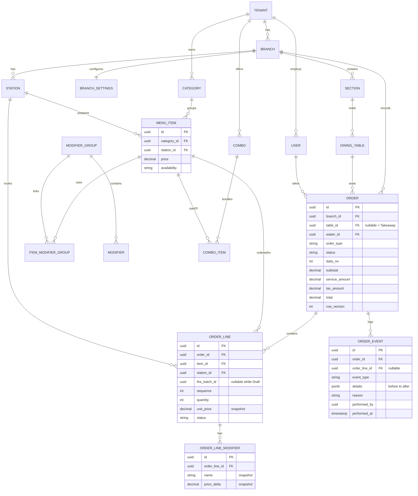

# Domain Model (Phase 1)

> The full domain is designed here; the **Phase 1 database** implements only the entities
> marked **[P1]**. Later-phase entities are listed so the seams are visible, but are **not**
> created as tables yet.

---

## 1. Bounded contexts

| Context | Phase | Responsibility |
|---|---|---|
| Tenant & Branch | P1 | Accounts, branches, per-branch settings (currency, tax, service). |
| Identity & Access | P1 | Users, roles, permissions — provided by **KimooKit**. |
| Dining Area | P1 | Sections and tables. |
| Menu | P1 | Categories, items, reusable modifier groups, combos, availability. |
| Ordering | P1 | Orders, order lines, fire batches, order events. |
| Kitchen Display (KDS) | P1 | Station-scoped views over fired lines. |
| Billing | P1 | Receipt snapshot, tax/service computation. No payment capture yet. |
| Payments | P2 | Multiple payments per order, allocation. |
| Reservations | P2 | Future table bookings. |
| Inventory | P3 | Stock deduction, purchase orders. |
| Loyalty | P3 | Customer accounts, points. |

## 2. Entities — Phase 1 database subset

Fields listed are the load-bearing ones, not the full column set. `id`, `tenant_id`,
`created_at`, `updated_at` are implied on every row unless stated.

### Tenant & Branch
- **Tenant** — the business account. `name`, `type` (restaurant / cafe / cloud_kitchen).
- **Branch** — a physical location. `tenant_id`, `name`. *(One active branch in P1; column present for the future.)*
- **BranchSettings** — `branch_id`, `currency`, `tax_rate`, `tax_applies` (bool),
  `service_charge_rate`, `service_applies` (bool), `tax_on_service` (bool — whether tax is
  computed on subtotal+service or subtotal only).

### Identity & Access (KimooKit)
- **User** — `tenant_id`, `display_name`, `role`. Auth, hashing, JWT, membership handled by KimooKit.
- **Role** — Owner, Manager, Cashier, Waiter, Kitchen. Permissions attach to roles.

### Dining Area
- **Section** — `branch_id`, `name` (Indoor, Terrace, …).
- **DiningTable** — `section_id`, `label`, `status` (Available / Occupied).

### Stations
- **Station** — `branch_id`, `name` (Grill, Bar, Dessert). A kitchen preparation area with its
  own KDS screen. `MenuItem.station_id` and `OrderLine.station_id` reference it; the KDS is
  scoped per station. *(Branch-scoped; one active branch in P1.)*

### Menu
- **Category** — `tenant_id`, `name`, `sort_order`.
- **MenuItem** — `category_id`, `station_id`, `price`, `availability`
  (Available / OutOfStock / Hidden).
- **ModifierGroup** — `name`, `min_select`, `max_select`, `required`. **Reusable.**
- **Modifier** — `group_id`, `name`, `price_delta`.
- **ItemModifierGroup** — join: `item_id`, `group_id`. Links a reusable group to many items.
- **Combo** — `tenant_id`, `name`, `price`.
- **ComboItem** — join: `combo_id`, `item_id`, `quantity`.

### Ordering
- **Order** — `branch_id`, `table_id` (nullable → Takeaway), `waiter_id`, `order_type`
  (DineIn / Takeaway), `status` (Open / InProgress / Completed / Cancelled), `daily_no`
  (call number for Takeaway), `customer_name` (nullable, Takeaway only),
  `subtotal`, `service_amount`, `tax_amount`, `discount_amount`,
  `total` (all **snapshotted at close**), `row_version` (optimistic concurrency).
- **OrderLine** — `order_id`, `item_id`, `station_id`, `fire_batch_id` (nullable while Draft),
  `sequence`, `quantity`, `unit_price` (**snapshot**), `status`
  (Draft / Fired / Preparing / Ready / Served / Voided).
- **OrderLineModifier** — `order_line_id`, `name` (**snapshot**), `price_delta` (**snapshot**).
  Not an FK to `Modifier` — the chosen modifier is frozen at order time.
- **OrderEvent** — the audit log. `order_id`, `order_line_id` (nullable), `event_type`
  (Created / Fired / Modified / Voided / Refired / QuantityChanged / Completed / …),
  `details` (jsonb, before→after), `reason`, `performed_by`, `performed_at`.
  **Append-only and immutable — never UPDATE or DELETE.**

> **KitchenTicket is intentionally NOT an entity in Phase 1.** A "ticket" is a **view**:
> the set of order lines sharing an `(order_id, station_id, fire_batch_id)`. If a later
> phase needs a ticket as a first-class aggregate (reprint, recall, partial fire), it is
> added with `KitchenTicket.fire_batch_id` — an additive migration, not a rewrite.

> **Receipt is also NOT an entity in Phase 1.** The receipt is the completed `Order`'s
> snapshotted totals rendered for print; the API's `receiptId` **is** the `orderId`. A
> first-class `Receipt` / `Payment` record is a Phase 2 seam.

## 3. Key modeling decisions (rationale)

1. **Snapshot over reference.** Lines and modifiers store `name` + `price` at order time.
   A later menu price change never rewrites historical orders or receipts.
2. **FireBatchId, not TicketNo.** The fired batch is the *event that happened*; the kitchen
   ticket is a *representation* of it. Naming it by the event keeps future ticket-entity
   migration trivial.
3. **Per-line lifecycle.** Status lives on `OrderLine`, not `Order`. This allows mixed
   states (one line Ready while another Preparing) and makes modification rules precise.
4. **OrderEvent as real audit.** Append-only + `order_line_id` nullable + `details` jsonb
   (before→after) turns a shallow log into a true audit trail that can answer
   "who voided 20 pizzas at 9 PM, and what were they?"
5. **Reusable modifier groups.** A group like *Size* or *Sugar level* is defined once and
   linked to many items via `ItemModifierGroup`. Deferring this later would force a data
   migration — cheaper to do now.
6. **Multi-tenant via RLS.** `tenant_id` (and `branch_id`) on every row; PostgreSQL
   row-level security enforces isolation *below* the application, via `ITenantContext`
   (same pattern as KimooKit). `branch_id` is carried from day one even with one branch.
7. **OrderType from day one.** Enum `{DineIn, Takeaway}` in P1, extensible to
   `{Delivery, DriveThru}`. `table_id` is nullable so non-dine-in channels reuse the same
   `Order`.
8. **Bill computed, then snapshotted at close.** Totals are stored on `Order` when it moves
   to `Completed`, so historical receipts stay correct when tax/service rates change later.

## 4. Phase 1 entity-relationship diagram

## 5. Glossary

| Term | Meaning |
|---|---|
| **Tenant** | A business account (one restaurant/cafe brand). |
| **Branch** | A physical location under a tenant. |
| **Station** | A kitchen preparation area with its own KDS screen (Grill, Bar, Dessert). |
| **Fire** | The act of sending drafted lines to the kitchen. |
| **Fire Batch** | The group of lines fired together in one action (`fire_batch_id`). |
| **Ticket** | The kitchen's view of one fire batch at one station (a *view*, not a table). |
| **Line** | One ordered item (`OrderLine`) with its own status. |
| **Modifier** | An option on an item (extra cheese, no onion, large). |
| **Combo** | A bundle of items sold as one priced unit. |
| **Void** | Cancelling a line after it was fired (requires reason + permission). |
| **86 / OutOfStock** | Item temporarily unavailable today; shown but not orderable. |
| **Bump** | Kitchen marking a ticket/line as done (Ready). |
| **Snapshot** | A frozen copy of a value (price, name, totals) captured at a point in time. |
