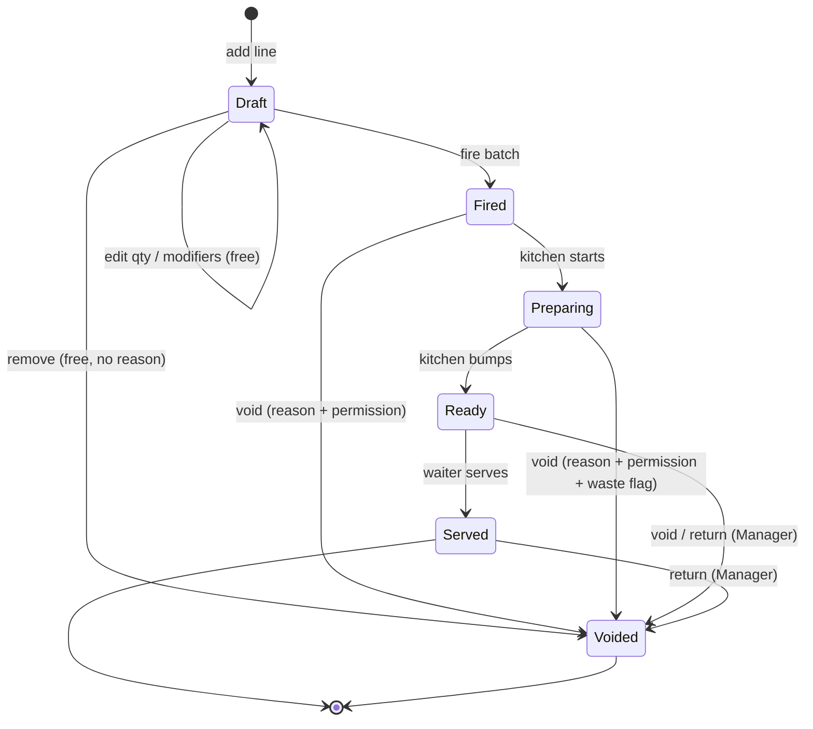
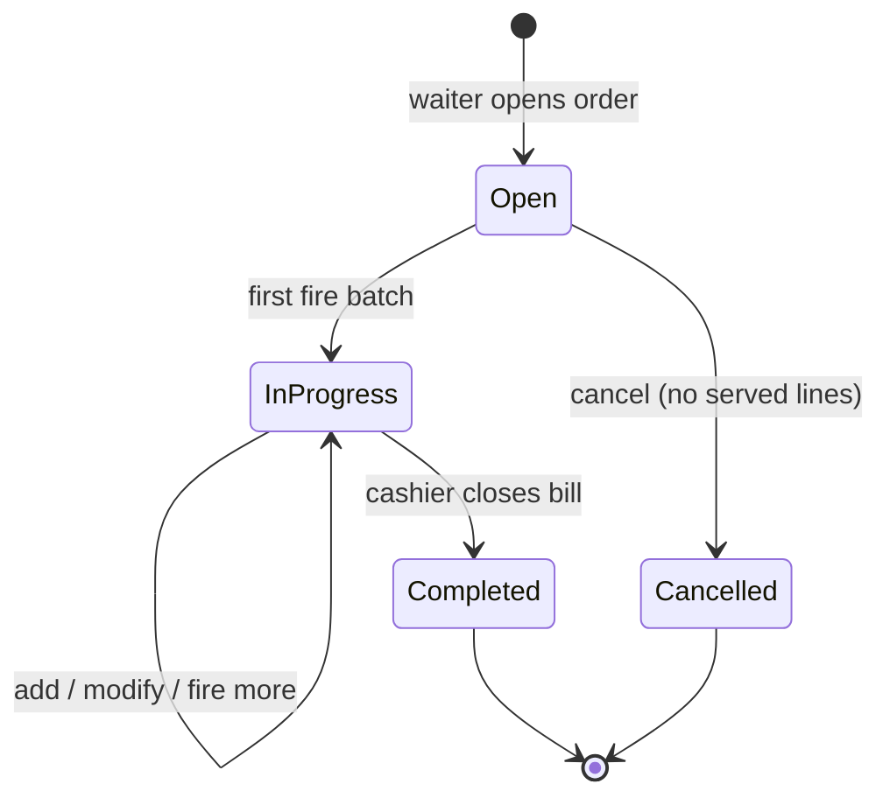
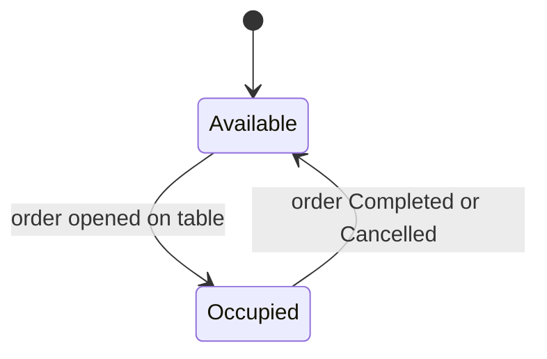

# State Machines (Phase 1)

> Three entities have a lifecycle: **OrderLine** (the important one), **Order**, and
> **DiningTable**. Transitions here are the source of truth; the Business Rules document
> references these states by name.

---

## 1. OrderLine

The heart of the system. Every ordered item moves independently through these states.

| State | Meaning |
|---|---|
| **Draft** | On the waiter's tablet, not yet sent to the kitchen. Freely editable. |
| **Fired** | Sent to the kitchen in a fire batch. Visible on the KDS, not started. |
| **Preparing** | Kitchen has started cooking it. |
| **Ready** | Finished by the kitchen, waiting to be served. |
| **Served** | Delivered to the customer. |
| **Voided** | Cancelled after firing (terminal). Requires reason + permission. |

**Transition guards**

- `Draft → Fired` requires the line to belong to an `Open` order and the item to be
  `Available`.
- `Fired → Voided`, `Preparing → Voided` require a **reason** and a role permitted to void
  (see Business Rules BR-M). A `Preparing → Voided` transition sets a **waste flag** in the
  `OrderEvent` details for future inventory reconciliation.
- Edits to a `Fired`/`Preparing` line are **not** in-place state changes on the line's
  content; they are **new events** that emit a KDS alert (see BR-M-04).

## 2. Order

The order's status is partly **derived** from its lines and partly **explicit**
(cashier action).

| State | Meaning |
|---|---|
| **Open** | Created, has draft or fired lines, still being worked. |
| **InProgress** | At least one line fired; kitchen/service underway. |
| **Completed** | Cashier closed the order; totals snapshotted; table released. |
| **Cancelled** | Whole order cancelled before any meaningful service (all lines voided). |

**Rules**

- An order **shall not** reach `Completed` while any line is still `Fired` or `Preparing`
  (all lines must be `Served` or `Voided`) — see BR-B-05.
- `Cancelled` is only permitted when no line has reached `Served`; otherwise the order is
  `Completed` with voided lines recorded.
- Moving to `Completed` computes and **snapshots** `subtotal`, `service_amount`,
  `tax_amount`, `total` onto the order.

## 3. DiningTable

Phase 1 keeps this minimal. `Reserved`, `Dirty`/`Cleaning` are deferred to later phases.

| State | Meaning |
|---|---|
| **Available** | Free to seat. |
| **Occupied** | Has one `Open`/`InProgress` order. |

**Rule**

- A `DiningTable` **shall** have **at most one** non-closed order at a time (enforced by a
  unique constraint — see BR-C-03). This is what makes the table status trustworthy across
  multiple waiters.

## 4. Fire-batch flow (not a state machine, but the key sequence)

1. Waiter adds lines → they are `Draft`.
2. Waiter fires → the server assigns a single `fire_batch_id` to that batch, moves the lines
   to `Fired`, writes an `OrderEvent (Fired)`, and broadcasts each line to its station's KDS.
3. Adding more lines later → a **new** fire batch. Previous batches are never touched.
4. The KDS renders one **ticket per `(order, station, fire_batch)`**.
