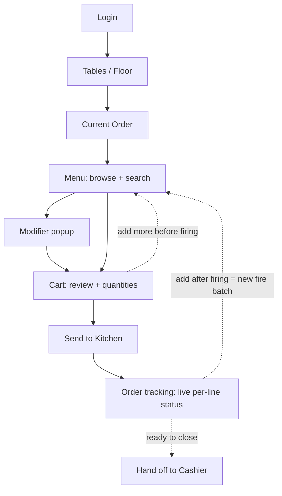
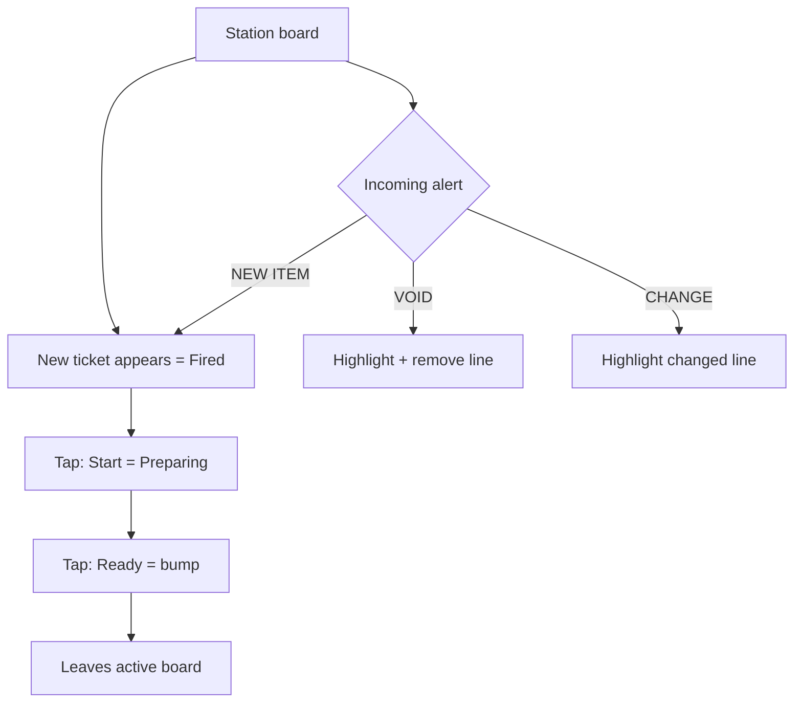
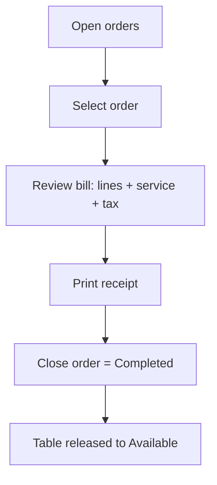
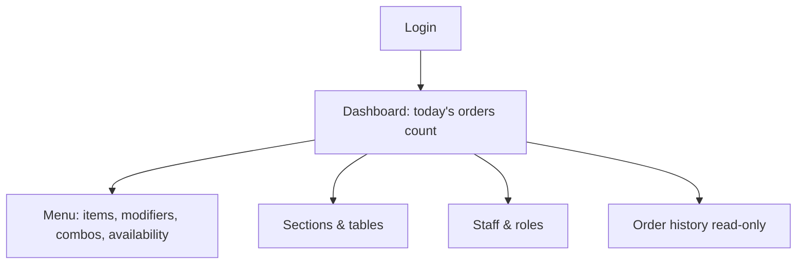

# Screen Flows (Phase 1)

> Each interface is treated as an **independent product** with its own UX, all sharing one
> backend and one domain. Phase 1 ships three daily-driver apps — **Waiter**, **KDS**,
> **Cashier** — plus a **minimal** Manager config surface. Customer display is a later phase.
>
> **Screen flows are the input to API design**, not a parallel track: the screens below
> define exactly which endpoints and payloads the backend must expose.

---

## 1. The governing principle: the domain generates the UI

The UI is a projection of the domain state — never invented separately.

| Domain fact | UI consequence |
|---|---|
| `ModifierGroup` (min/max/required) on an item | Modifier popup with single/multi select and validation |
| `MenuItem.availability = OutOfStock` | Button shown greyed-out, not addable |
| `MenuItem.availability = Hidden` | Item not rendered at all |
| `OrderLine.status = Preparing / Ready` | Row colour (amber / green) on tablet and KDS |
| `OrderType = Takeaway` | Table step skipped; customer name + `daily_no` captured |
| `Order.row_version` mismatch | "Order changed — refresh" prompt instead of silent overwrite |
| Fire batch | KDS renders one ticket per `(order, station, fire_batch)` |

## 2. Per-app UX north star

- **Waiter (Flutter tablet)** — fast, one-handed, usable while standing and moving. Big
  tap targets, minimal typing, menu reachable in ≤ 2 taps, draft-safe if the network drops.
- **KDS (large screen, React)** — glanceable from across the kitchen. Colour and status
  over text. Zero navigation, zero distraction — tickets in, bump out. Loud, unmissable
  alerts for NEW / VOID / CHANGE.
- **Cashier (tablet/desktop, React)** — review-and-close focused: open orders, bill review,
  print, close. Payment capture is Phase 2.
- **Manager (desktop, React) — minimal in Phase 1** — menu, tables/sections, staff, and
  read-only order history. Full dashboards and reports are Phase 3.

## 3. Waiter app — screen flow

Notes: Takeaway skips `Tables` and instead captures a customer name and shows the assigned
`daily_no`. `Modifier popup` appears only for items that have modifier groups.

## 4. KDS — screen flow

The KDS is a **board**, not a navigation tree. One screen per station; tickets flow through
line states.

Notes: tickets are ordered by fire time then `sequence`. A line voided while `Preparing`
shows a clear VOID highlight before it is removed (BR-M-03), never a silent disappearance.

## 5. Cashier — screen flow

Notes: closing is blocked while any line is still `Fired`/`Preparing` (BR-B-05). Totals are
snapshotted on close (BR-B-03). No payment step in Phase 1 (BR-B-06).

## 6. Manager — minimal Phase 1 surface

## 7. Build strategy — vertical slices, not horizontal layers

Do **not** build all Flutter UI first and all backend after — that defers integration to
the end where every problem detonates at once. Build one feature end-to-end, validate it,
then move on. Suggested slice order:

1. **Auth + branch context** (KimooKit login → tenant/branch resolved).
2. **Open table → add draft line** (Tables + Menu + Cart, minimal Order/OrderLine API).
3. **Fire + KDS receive** (fire batch, SignalR, one KDS station rendering a ticket).
4. **Per-line status round-trip** (Start/Ready on KDS → live update on tablet).
5. **Modify / void with audit** (OrderEvent, KDS alerts, permission rules).
6. **Close + receipt** (totals snapshot, ESC/POS print).
7. **Availability + offline hardening** (85/86 states, tablet offline sync).

Each slice is a small, testable increment that adds visible value and keeps the system
integrated at all times.

## 8. Next artifacts

- **Wireframes** for the Waiter, KDS, and Cashier apps — produced as real interactive
  mockups rather than ASCII sketches (higher fidelity, directly reviewable).
- **API contracts** derived from these flows (endpoints, payloads, error/conflict shapes).
